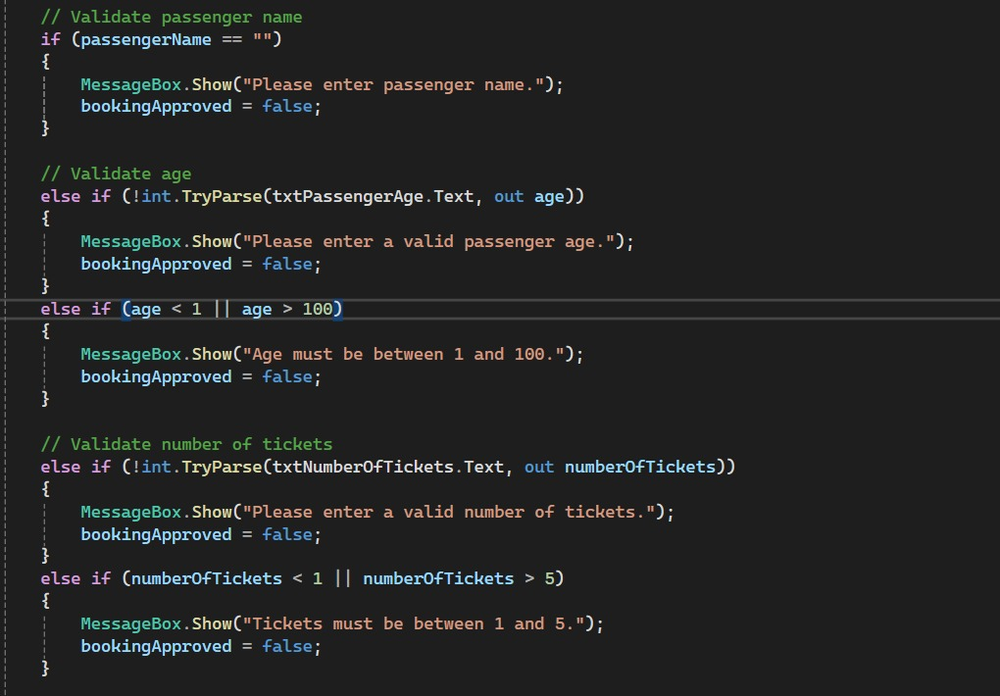
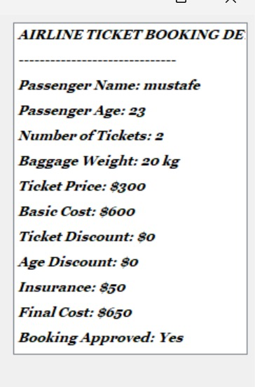

# C# Airline Ticket Booking System and ListBox Control

# Part 1: Airline Ticket Booking System

# 1. Introduction

The Airline Ticket Booking System is a C# Windows Forms application used to manage airline ticket bookings and validate passenger information.

# 

# 2. If Statement

The "if" statement executes code when a condition is true.

if (passengerName == "")
{
    MessageBox.Show("Please enter passenger name.");
    bookingApproved = false;
}

- "passengerName == """ checks whether the name is empty.
- "MessageBox.Show()" displays an error message.
- "bookingApproved = false" rejects the booking.

# 3. Else If Statement

The "else if" statement checks another condition when the previous condition is false.

else if (age < 1 || age > 100)
{
    MessageBox.Show("Age must be between 1 and 100.");
    bookingApproved = false;
}

- "<" means less than.
- ">" means greater than.
- "||" means OR.

# 4. Else Statement

The "else" statement executes when the preceding condition is false.

if (age >= 18)
{
    MessageBox.Show("Adult");
}
else
{
    MessageBox.Show("Under 18");
}

- If the age is 18 or above, the program displays Adult.
- Otherwise, it displays Under 18.

# 5. int.TryParse() Method

The "int.TryParse()" method checks whether text can be converted into an integer.

else if (!int.TryParse(txtPassengerAge.Text, out age))
{
    MessageBox.Show("Please enter a valid passenger age.");
    bookingApproved = false;
}

- "txtPassengerAge.Text" contains the entered age.
- "out age" stores the converted number.
- "!" means NOT.
- Invalid input causes an error message.

# 6. Ticket Validation

This condition allows between 1 and 5 tickets.

else if (numberOfTickets < 1 || numberOfTickets > 5)
{
    MessageBox.Show("Tickets must be between 1 and 5.");
    bookingApproved = false;
}

The booking is rejected if the number of tickets is outside the permitted range.

# 7. Important Operators

Operator| Meaning
"if"| Checks a condition
"else if"| Checks another condition
"else"| Runs when previous conditions are false
"=="| Equal to
"!"| NOT
`| 
"&&"| AND
"<"| Less than
">"| Greater than
"true"| True value
"false"| False value

Picture 2: C# ListBox Control

# 

# 1. General Explanation

A "ListBox" is a Windows Forms control used to display a list of items. Users can select one or more items depending on its settings.

Examples include passenger names, student names, subjects, and ticket types.

# 2. Adding Items

The "Items.Add()" method adds items to a ListBox.

listBox1.Items.Add("Mustafe");
listBox1.Items.Add("Ahmed");
listBox1.Items.Add("Mohamed");

- "listBox1" is the control name.
- "Items.Add()" adds each name to the list.

# 3. ListBox Properties

Property| Description
"Name"| Sets the control name
"Items"| Contains list items
"SelectedItem"| Gets the selected item
"SelectedIndex"| Gets the selected item's index, starting at 0
"SelectionMode"| Controls single or multiple selection
"Sorted"| Sorts items when true
"MultiColumn"| Displays multiple columns
"HorizontalScrollbar"| Shows a horizontal scrollbar when needed
"Enabled"| Enables or disables the control
"Visible"| Shows or hides the control
"BackColor"| Changes the background color
"ForeColor"| Changes the text color
"Font"| Changes the font
"Size"| Sets the width and height

# 4. ListBox Methods

Add an Item

listBox1.Items.Add("Mustafe");

Adds an item to the list.

Remove an Item

listBox1.Items.Remove("Mustafe");

Removes the specified item.

Clear All Items

listBox1.Items.Clear();

Removes all items from the list.

# 5. Getting the Selected Item

The following code displays the selected item.

if (listBox1.SelectedItem != null)
{
    MessageBox.Show(listBox1.SelectedItem.ToString());
}

- "SelectedItem" gets the selected item.
- "!= null" checks that an item is selected.
- "ToString()" converts the item into text.

# 6. ListBox Event

The "SelectedIndexChanged" event occurs when the selected item changes.

private void listBox1_SelectedIndexChanged(object sender, EventArgs e)
{
    if (listBox1.SelectedItem != null)
    {
        MessageBox.Show(listBox1.SelectedItem.ToString());
    }
}

When a user selects an item, the program displays its name.

# 7. Adding a ListBox in Visual Studio

1. Open your Windows Forms project.
2. Open the Form Designer.
3. Find ListBox in the Toolbox.
4. Drag it onto the Form.
5. Select it and open the Properties window.
6. Change its name and properties if needed.