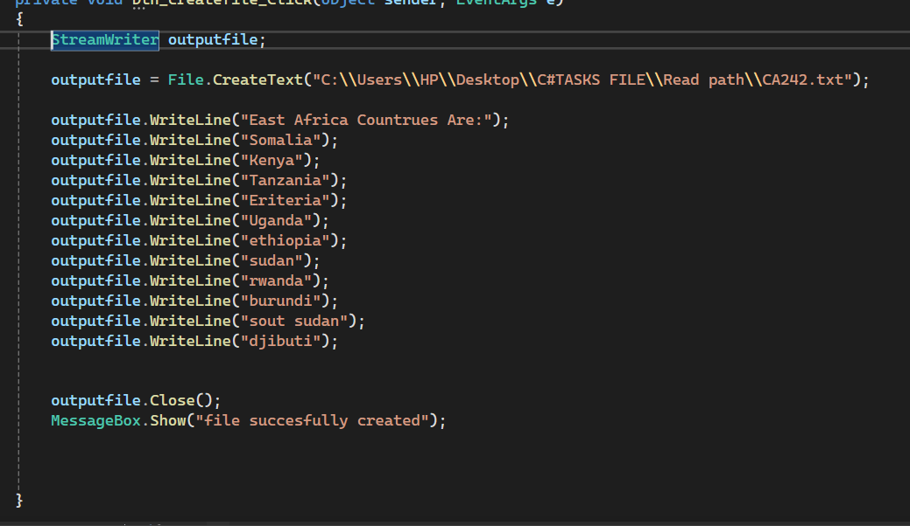
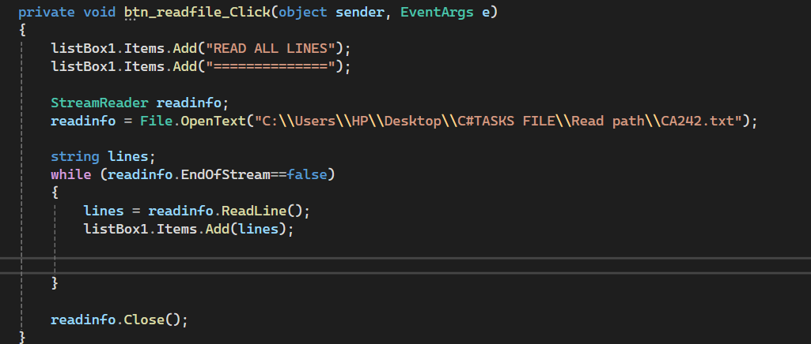

# C# File Handling

# Description

This picture demonstrates a C# Windows Forms application that creates a text file, writes information into it, and reads the saved information. The data is displayed in a ListBox.

# Objectives

- To create a text file.
- To write information into a file.
- To read information from a file.
- To display file contents in a ListBox.
- To understand how StreamWriter and StreamReader work.

Technologies Used

- C#
- Windows Forms
- StreamWriter
- StreamReader
- File.CreateText()
- File.OpenText()
- ListBox

Picture 1: Creating and Writing to a File

# Description

Picture 1 shows how to create a text file and write information about East African countries into it.

# How It Works

1. The program declares a StreamWriter object named outputfile.
2. File.CreateText() creates the text file named CA242.txt.
3. WriteLine() writes the heading and names of East African countries into the file.
4. Close() closes the file after writing.
5. MessageBox.Show() displays a message confirming that the file was created successfully.

# Countries Stored in the File

- Somalia
- Kenya
- Tanzania
- Eritrea
- Uganda
- Ethiopia
- Sudan
- Rwanda
- Burundi
- South Sudan
- Djibouti
# Important Methods

Method| Purpose
File.CreateText()| Creates a text file.
WriteLine()| Writes text into the file.
Close()| Closes the file.
MessageBox.Show()| Displays a confirmation message.

# Picture 2: Reading Data from a File

# Description

Picture 2 shows how to open an existing text file, read its contents line by line, and display the information in a ListBox.

# How It Works

1. The program adds a heading to listBox1.
2. It declares a StreamReader object named readinfo.
3. File.OpenText() opens the CA242.txt file.
4. A string variable named lines stores each line read from the file.
5. The while loop continues until the end of the file is reached.
6. ReadLine() reads one line at a time.
7. Items.Add() displays each line in the ListBox.
8. Close() closes the file after reading.

# Important Methods

Method| Purpose
File.OpenText()| Opens an existing text file for reading.
ReadLine()| Reads one line from the file.
EndOfStream| Checks whether the end of the file has been reached.
Items.Add()| Adds information to the ListBox.
Close()| Closes the file.

# How the Program Works

1. The user clicks the Create File button.
2. The program creates CA242.txt.
3. It writes the heading and country names into the file.
4. A success message appears.
5. The user clicks the Read File button.
6. The program opens the file.
7. It reads the contents line by line.
8. The information appears in the ListBox.
9. The file is closed after reading.

# File Information

File Name: CA242.txt

File Type: Text File

File Location: C:\Users\HP\Desktop\C#TASKS FILE\Read path\CA242.txt

Note: The file path must exist on the computer running the program. If the file is saved in another location, update the path accordingly.

# Difference Between StreamWriter and StreamReader

StreamWriter| StreamReader
Writes information into a file.| Reads information from a file.
Used when creating or writing files.| Used when opening and reading files.
Uses methods such as WriteLine().| Uses methods such as ReadLine().

# Expected Output

When the Create File button is clicked, the program saves the country names in CA242.txt and displays a success message.

When the Read File button is clicked, the program displays the heading and country names inside the ListBox.

# Conclusion

This picture demonstrates basic file handling in C# using Windows Forms. Picture 1 focuses on creating and writing to a text file, while Picture 2 focuses on reading and displaying the saved information. Together, they demonstrate how to store and retrieve data using StreamWriter and StreamReader.